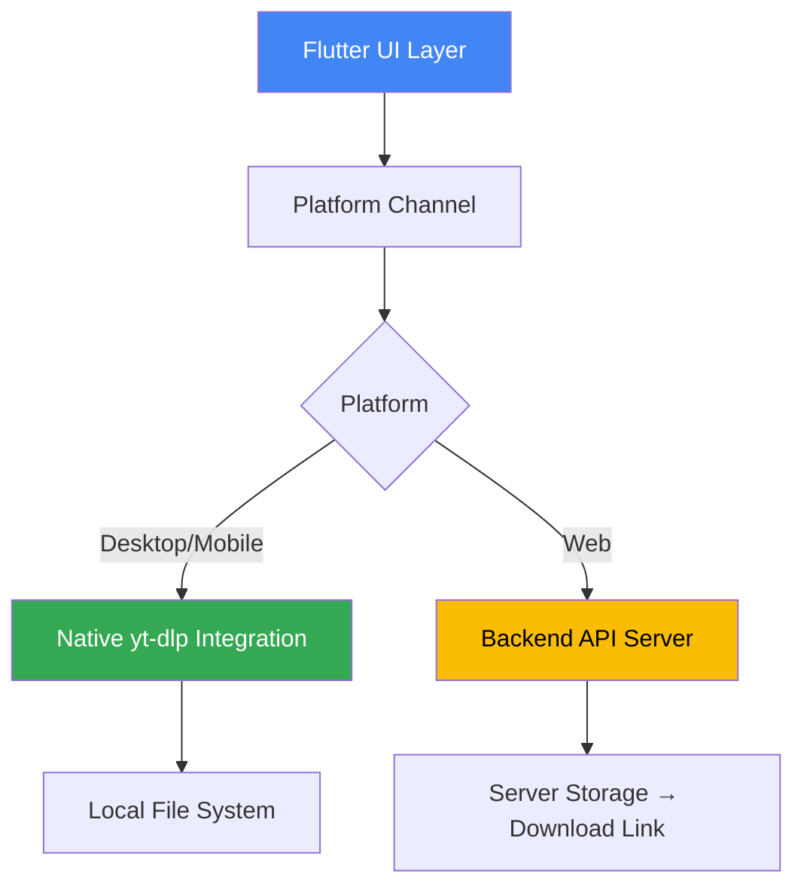

# Technology Stack Recommendation for UniDownloader

## Executive Summary

Based on your requirements for a **cross-platform video/audio downloader** that works on **Web, Desktop (macOS, Windows, Linux), and Mobile (Android, iOS)**, here's my recommendation:

## 🎯 Recommended Technology Stack

### **Option 1: Flutter (RECOMMENDED)**
**Best for:** Maximum platform coverage with single codebase

| Platform | Support | Details |
|----------|---------|---------|
| **Web** | ✅ Excellent | Production-ready, compiles to optimized JavaScript |
| **Desktop** | ✅ Excellent | macOS, Windows, Linux (stable) |
| **Mobile** | ✅ Excellent | Android & iOS (mature, widely used) |
| **iPad** | ✅ Native | Same as iOS build |

**Pros:**
- ✅ **Single codebase** for all 5+ platforms (Web, macOS, Windows, Linux, Android, iOS)
- ✅ **Native performance** on mobile (compiles to native code)
- ✅ **Beautiful, customizable UI** with Material/Cupertino widgets
- ✅ **Large ecosystem** with packages for video downloading (yt-dlp wrapper, FFmpeg)
- ✅ **Hot reload** for fast development
- ✅ **Your existing experience** (you've worked with Flutter based on conversation history)
- ✅ **Strong community** and Google backing

**Cons:**
- ⚠️ Web version has slightly larger bundle size (~2MB initial load)
- ⚠️ Backend operations (actual downloading) need platform-specific handling

---

### **Option 2: Electron + React (Alternative)**
**Best for:** Web-first approach with desktop support

| Platform | Support | Details |
|----------|---------|---------|
| **Web** | ✅ Excellent | Native environment |
| **Desktop** | ✅ Excellent | macOS, Windows, Linux |
| **Mobile** | ❌ No | Requires React Native (different codebase) |

**Pros:**
- ✅ Web technologies (HTML/CSS/JS)
- ✅ VidBee project is already Electron-based
- ✅ Easier web deployment

**Cons:**
- ❌ **No mobile support** without rewriting in React Native
- ❌ Large desktop app sizes (100MB+)
- ❌ Higher memory usage

---

### **Option 3: Python + Flet (What you've been using)**
**Best for:** Rapid prototyping with Python backend

| Platform | Support | Details |
|----------|---------|---------|
| **Web** | ✅ Good | Runs in browser via WebAssembly |
| **Desktop** | ✅ Good | macOS, Windows, Linux |
| **Mobile** | ⚠️ Limited | Beta support for iOS/Android |

**Pros:**
- ✅ Python backend (great for yt-dlp integration)
- ✅ Quick development
- ✅ Your existing UniDownloader work

**Cons:**
- ❌ **Mobile support is still experimental**
- ❌ Smaller community compared to Flutter
- ❌ Performance limitations on web (WebAssembly overhead)
- ❌ Not ideal for production mobile apps

---

## 🏆 Final Recommendation: **Flutter**

### Why Flutter is the Best Choice for Your Project:

1. **True Cross-Platform**: One codebase → Web + Desktop (3 OS) + Mobile (2 OS) = 6 platforms
2. **Production Ready**: Used by Google, Alibaba, BMW, eBay for all platforms
3. **Performance**: Near-native performance on mobile, good performance on web/desktop
4. **UI Flexibility**: Can replicate Seal's beautiful UI exactly
5. **Future-Proof**: Active development, growing ecosystem
6. **You Already Know It**: Your Flutter experience from the Nifty 50 app project

### Architecture Approach



**For Desktop & Mobile**: Direct yt-dlp integration using platform channels
**For Web**: Backend API server (Python Flask/FastAPI) that handles downloads and sends files to user

---

## 📋 Implementation Plan

### Phase 1: Core Flutter App (Desktop + Mobile)
1. **Setup Flutter project** with proper folder structure
2. **UI Implementation**:
   - Main screen with URL input field
   - "Paste from Clipboard" button
   - Download button with progress indicator
   - Settings screen for download location
3. **Integrate yt-dlp** (via Python subprocess or Dart wrapper)
4. **Playlist Support**:
   - Fetch playlist metadata
   - Display videos with thumbnails
   - Checkboxes for individual selection
   - "Select All" / "Deselect All" toggle
5. **Smart Folder Organization**:
   - Main download folder setting
   - Auto-create playlist/channel folders
   - Persist user preferences

### Phase 2: Web Version
1. **Build web-optimized Flutter app**
2. **Create backend API** (Python FastAPI recommended):
   - `/api/extract-info`: Get video/playlist metadata
   - `/api/download`: Process download request
   - `/api/status`: Check download progress
3. **Deploy backend** to cloud (Render, Railway, or Fly.io)
4. **Deploy frontend** to Vercel/Netlify/Firebase Hosting

### Phase 3: Platform-Specific Builds
1. **Android**: Build APK/AAB for Play Store
2. **iOS**: Build IPA (requires Mac + Apple Developer account)
3. **macOS**: Build DMG/PKG
4. **Windows**: Build installer (MSIX/EXE)
5. **Linux**: Build AppImage/Snap/Flatpak

---

## 🔧 Key Technologies & Libraries

### Flutter Packages:
```yaml
dependencies:
  # UI
  flutter:
    sdk: flutter
  material_design_icons_flutter: ^7.0.0
  
  # State Management
  provider: ^6.1.0  # or riverpod
  
  # Networking
  http: ^1.2.0
  dio: ^5.0.0  # Advanced HTTP client
  
  # File System
  path_provider: ^2.1.0  # Access app directories
  file_picker: ^6.0.0  # Custom folder selection
  
  # Clipboard
  clipboard: ^0.1.3
  
  # Platform Channels (for yt-dlp)
  flutter_platform_interface: ^2.1.0
  
  # Video Processing (if needed)
  video_player: ^2.8.0
  
  # Settings Persistence
  shared_preferences: ^2.2.0
  
  # Desktop/Mobile specific
  window_manager: ^0.3.0  # Desktop window control
```

### Backend (for Web Support):
```python
# Python Backend (FastAPI)
fastapi
uvicorn
yt-dlp
ffmpeg-python
python-multipart
```

---

## 🌐 Deployment Strategy

### Web Version:
- **Frontend**: Vercel/Netlify (free tier, auto-deploy from GitHub)
- **Backend API**: Railway/Render (free tier available)
- **URL**: `https://unidownloader.app` (example)

### Desktop:
- **Distribution**: GitHub Releases
- **Auto-updates**: Built-in Flutter desktop support

### Mobile:
- **Android**: Google Play Store + APK on GitHub
- **iOS**: Apple App Store (requires $99/year developer account)

---

## 💰 Cost Estimate

| Item | Cost | Notes |
|------|------|-------|
| **Development** | $0 | All tools are free |
| **Web Hosting** | $0-10/month | Free tier available (Vercel + Railway) |
| **Domain** | $10-15/year | Optional |
| **Apple Developer** | $99/year | Required for iOS App Store |
| **Google Play** | $25 one-time | Optional (can distribute APK free) |

**Total to launch all platforms**: **$0-134/year** (can start with $0 using free tiers and direct APK distribution)

---

## 🎨 UI Design Reference

Based on the Seal app screenshots you provided:

### Key UI Elements to Implement:
1. ✅ **Clean Material Design** with rounded cards
2. ✅ **Video thumbnails** in playlist view
3. ✅ **Checkboxes** for video selection
4. ✅ **Progress indicators** during download
5. ✅ **Settings modal** for download configuration
6. ✅ **Format/Quality selector** (video quality, audio-only, etc.)
7. ✅ **Custom commands/templates** support
8. ✅ **Download history** page
9. ✅ **Dark/Light theme** toggle

---

## 📱 Supported Platforms & Features Matrix

| Feature | Web | Desktop | Mobile |
|---------|-----|---------|--------|
| URL Paste | ✅ | ✅ | ✅ |
| Clipboard Auto-Read | ⚠️ Limited | ✅ | ✅ |
| Playlist Selection | ✅ | ✅ | ✅ |
| Custom Download Location | ❌ (browser default) | ✅ | ✅ (app folder) |
| Auto Folder Organization | ❌ | ✅ | ✅ |
| Background Downloads | ❌ | ✅ | ✅ |
| Video Quality Selection | ✅ | ✅ | ✅ |
| Audio Extraction | ✅ | ✅ | ✅ |

---

## ⚡ Quick Start Recommendation

### Start Here:
1. **Week 1**: Build Flutter desktop app with core features
2. **Week 2**: Test on macOS, add playlist support
3. **Week 3**: Build mobile versions (Android first, then iOS)
4. **Week 4**: Create web version with backend API
5. **Week 5**: Polish UI, add advanced features
6. **Week 6**: Testing & deployment

---

## 🤔 Decision Time

**My Strong Recommendation**: Go with **Flutter** for your UniDownloader project.

### Next Steps if You Agree:
1. ✅ I'll create a fresh Flutter project structure
2. ✅ Set up the UI matching Seal's design with your branding
3. ✅ Implement core download functionality
4. ✅ Add playlist support with video selection
5. ✅ Build and test on your macOS first
6. ✅ Then expand to other platforms

### Alternative Path:
If you want to continue with Python/Flet for desktop only and wait for mobile support to mature, I can help refine your existing UniDownloader project instead.

---

**What would you like to proceed with?** 

A) **Flutter** (fresh start, all platforms)
B) **Improve existing Flet/Python** project (desktop + web only for now)
C) **Explore Electron + React Native** (separate codebases for web/desktop vs mobile)
